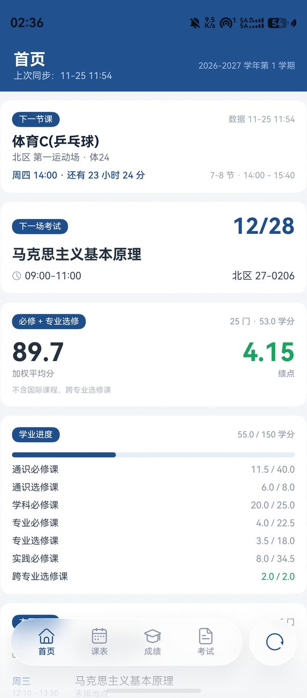
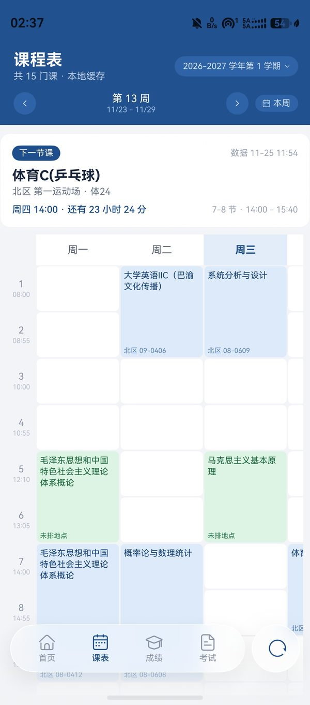
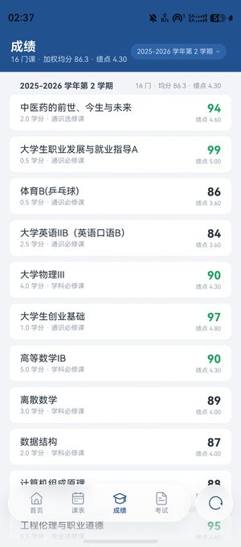
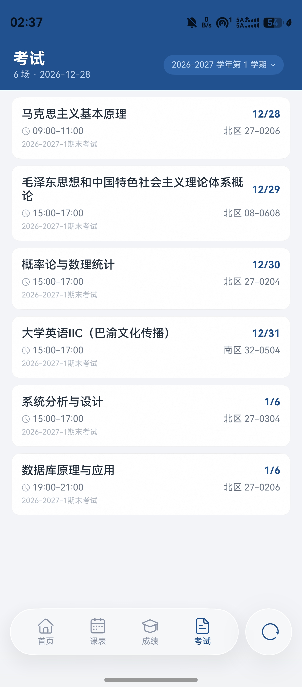
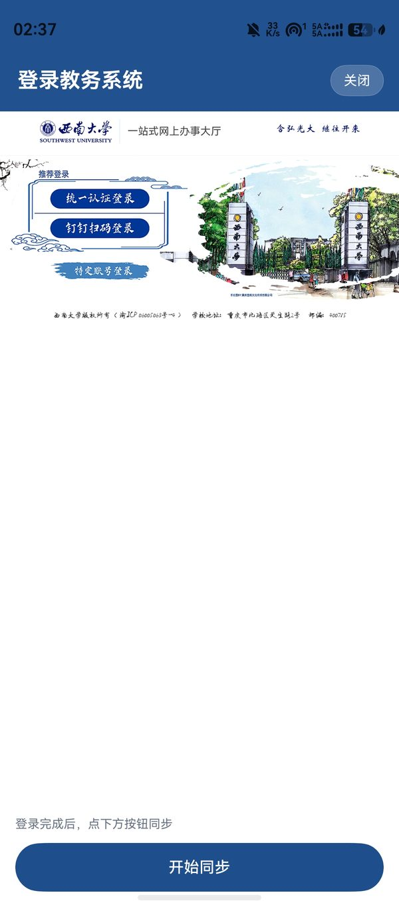
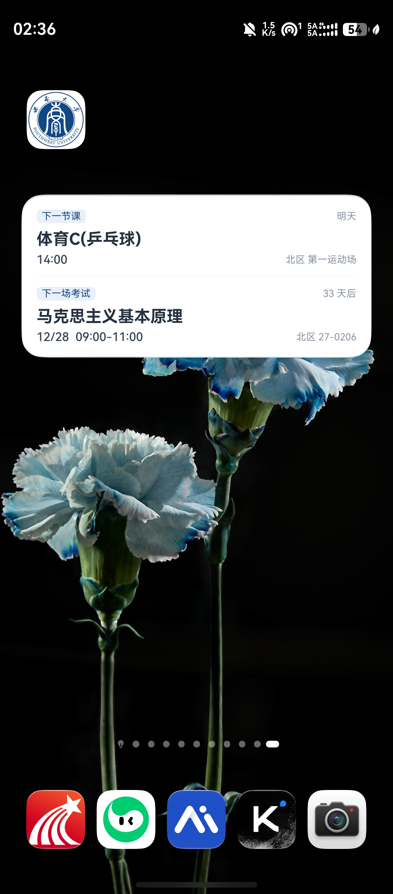

# SWU教务（西大课表）

西南大学（SWU）教务系统的第三方 HarmonyOS 客户端：课表、成绩、考试、学业进度一屏搞定，数据只存在本机。

> 个人自用项目，非学校官方应用。
>
> 作者：[@daomanliu](https://github.com/daomanliu)

## 截屏展示

<table>
  <tr>
    <td align="center"></td>
    <td align="center"></td>
    <td align="center"></td>
  </tr>
  <tr>
    <td align="center"></td>
    <td align="center"></td>
    <td align="center"></td>
  </tr>
</table>


## 功能

| 模块 | 说明 |
|---|---|
| 首页 | 下一节课 / 下一场考试 / 必修+专业选修加权均分与绩点 / 学业进度（学分要求） / 本周课程 |
| 课表 | 周视图、多学期切换、双指缩放、点课程看详情 |
| 成绩 | 按学期分组，加权均分与绩点，点成绩看详情 |
| 考试 | 按考试时间排序，点考试看考场/时段 |
| 同步 | 应用内 WebView 登录统一身份认证，手动触发一次性抓取课表 + 成绩 + 考试 + 学业进度 |
| 桌面卡片 | 2×4 服务卡片展示下一节课与下一场考试，长按卡片「添加至桌面」 |
| 外观 | 深色模式、沉浸光感材质、玻璃卡片、悬浮 miniBar 导航 |

## 技术要点

- **ArkTS / ArkUI**，targetSdkVersion 26.0.0
- 登录：ArkWeb 打开学校统一认证（uaaap.swu.edu.cn → idm.swu.edu.cn），通过 `WebCookieManager` 读取 cookie
- 抓取：`@kit.NetworkKit` HTTP 请求正方教务接口（课表 `N253508`、成绩 `N305005`、考试 `N358105`、学业进度 `N105515`），注意必须带 `Referer`
- 存储：`@kit.ArkData` preferences（`timetable_store`），全部数据仅本机
- 卡片：`FormExtensionAbility` + `form_config.json`，App 同步后通过 `formProvider.updateForm` 推送
- 导航：`@kit.UIDesignKit` 的 `HdsTabs` + `barFloatingStyle`（`systemMaterialEffect`、`adaptToHandedness`、`miniBar`）
- 光效：`hdsEffect.HdsEffectBuilder().pointLight()` 给卡片边缘加物理点光源

## 目录

```
entry/src/main/ets/
├── entryability/           应用入口（全屏、返回键）
├── entryformability/       服务卡片 FormExtensionAbility
├── model/
│   ├── JwSync.ets          教务接口抓取与解析
│   ├── TimetableRepo.ets   preferences 读写
│   └── TimetableData.ets   课表数据结构与时间工具
├── pages/
│   ├── Index.ets           首页 + 课表 + 成绩 + 考试 + 导航
│   └── SyncPage.ets        登录浮层与同步流程
└── widget/                 卡片页面与卡片数据
```

## 构建

```bash
# 需要 DevEco Studio 5.x + HarmonyOS SDK API 26
hvigorw assembleHap --mode module -p product=default
```

或直接用 DevEco Studio 打开工程，选择设备运行。

## 免责声明

- 本项目与西南大学无隶属关系，仅个人学习与自用
- 不会上传任何数据到第三方服务器，账号密码只在学校官方登录页输入
- 使用前请自行确认符合学校相关管理规定

## 欢迎参与

发现 bug 或想加功能，欢迎提 Issue 或直接 fork。
这个项目随时接受更好的实现，不必先问。

## License

MIT
